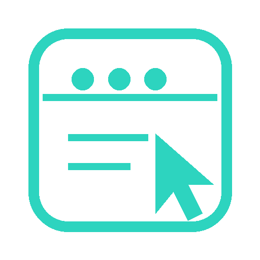

# AgentPilot

Your agent drives your phone. AgentPilot is an Android app that lets your AI agent use the real apps on your phone, starting with your own mobile browser.

## What it does

- Drives the real apps on your phone through Android Accessibility. No cloud browser, no laptop, no extension.
- Pick one app, turn on Accessibility once, and the app is ready. Setup is one-time.
- Your agent can open sites, tap, type, scroll, and take screenshots in the app you picked.
- Your agent never types a password. Login is always by hand, in the real app.

## Install

Download the latest APK from [Releases](https://github.com/ABlockBeat/AgentPilot/releases) and install it on your phone. After this version, the app updates itself from inside the app.

## Setup

1. Open AgentPilot.
2. Tap Set up and pick the app your agent may drive.
3. Turn on Accessibility for AgentPilot in your phone Settings.
4. Tap Start.
5. Log in to your accounts by hand, inside the real app.

## Build

Free, built on GitHub Actions. Every push builds a debug APK and publishes it as a release.
